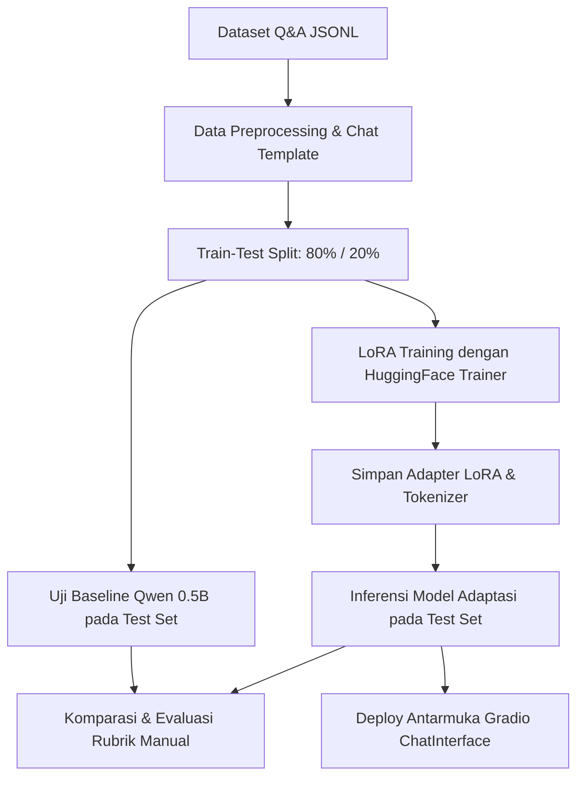

# EduBot — Chatbot Edukasi Sistem Informasi 🤖📚
> **Proyek Ujian Tengah Semester (UTS)**  
> **Mata Kuliah:** Sistem Informasi berbasis Kecerdasan Buatan  
> **Program Studi:** Sistem Informasi — Semester 3  

---

## 📌 Ringkasan Proyek

**EduBot** adalah prototipe asisten virtual edukasi berbasis *Large Language Model* (LLM) yang dirancang untuk menjawab pertanyaan seputar konsep dasar **Sistem Informasi (SI)**. 

Proyek ini mengadaptasi model dasar [**Qwen/Qwen2.5-0.5B-Instruct**](https://huggingface.co/Qwen/Qwen2.5-0.5B-Instruct) menggunakan teknik **Parameter-Efficient Fine-Tuning (PEFT)** dengan **LoRA (Low-Rank Adaptation)** dan kuantisasi **4-bit (QLoRA)**. Pendekatan ini memungkinkan proses adaptasi model domain-spesifik berjalan secara efisien pada komputasi hemat memori (seperti GPU gratis Google Colab T4) tanpa perlu melatih ulang seluruh bobot model dasar.

---

## 🎯 Tujuan Proyek

1. **Adaptasi Domain Khusus:** Menyesuaikan gaya respons dan pengetahuan model LLM agar menghasilkan jawaban ringkas, akurat, dan relevan dengan materi kuliah Sistem Informasi.
2. **Implementasi QLoRA:** Menerapkan teknik fine-tuning hemat sumber daya (*parameter-efficient*) menggunakan adapter LoRA pada lapisan modul target transformer.
3. **Evaluasi Empiris (Baseline vs Adapted):** Membandingkan performa model asli (*baseline*) dengan model setelah fine-tuning (*adapted*) menggunakan rubrik penilaian terstandar pada data uji yang tidak pernah dilihat model saat pelatihan.
4. **Prototipe Interaktif:** Mengembangkan antarmuka obrolan interaktif berbasis **Gradio ChatInterface** untuk demonstrasi langsung.

---

## 📂 Struktur Direktori Proyek

```plaintext
UTS/
├── edubot_uts_colab.ipynb        # Notebook Google Colab lengkap (Pipeline End-to-End)
├── edubot_si_qa.jsonl            # Dataset Q&A domain Sistem Informasi (format JSONL)
├── comparison_rubric.csv         # Hasil evaluasi perbandingan Baseline vs LoRA
├── training_metrics.json         # Metrik evaluasi pasca-pelatihan (eval_loss, dll.)
├── qwen_edubot_lora/             # Direktori penyimpanan adapter LoRA & tokenizer
│   ├── adapter_config.json       # Konfigurasi hyperparameter LoRA (r, alpha, target)
│   ├── adapter_model.safetensors # Bobot adapter terlatih (~17.6 MB)
│   ├── chat_template.jinja       # Jinja chat template untuk Qwen
│   ├── tokenizer.json            # Tokenizer vocabulary & merge rules
│   ├── tokenizer_config.json     # Konfigurasi tokenizer
│   └── README.md                 # Model Card Hugging Face LoRA
└── README.md                     # Dokumentasi utama proyek ini
```

---

## ⚙️ Spesifikasi & Hyperparameter Model

### 1. Model Dasar & Kuantisasi
- **Base Model:** `Qwen/Qwen2.5-0.5B-Instruct`
- **Kuantisasi:** 4-bit BitsAndBytes (`load_in_4bit=True`, `bnb_4bit_quant_type="nf4"`, `bnb_4bit_compute_dtype=float16`)
- **Mode Pelatihan:** Parameter-Efficient Fine-Tuning (PEFT)

### 2. Konfigurasi LoRA
- **LoRA Rank ($r$):** `8`
- **LoRA Alpha ($\alpha$):** `16`
- **LoRA Dropout:** `0.05`
- **Target Modules:** All linear attention & MLP projections (`q_proj`, `k_proj`, `v_proj`, `o_proj`, `gate_proj`, `up_proj`, `down_proj`)
- **Task Type:** `CAUSAL_LM`

### 3. Hyperparameter Training
- **Batch Size:** `1` (per device)
- **Gradient Accumulation Steps:** `8` (effective batch size: 8)
- **Learning Rate:** `2e-4`
- **Optimizer:** `paged_adamw_8bit`
- **Precision:** Mixed Precision (`fp16=True`)
- **Epochs:** `1`
- **Max Sequence Length:** `512` token

---

## 🔄 Alur Kerja (Pipeline) Proyek



1. **Penyusunan Dataset (`edubot_si_qa.jsonl`):**
   - Berisi pasang tanya-jawab konsep fundamental Sistem Informasi (SDLC, Normalisasi, UML Use Case, DBMS, CIA Triad, ERP, Etika AI di kampus).
   - Memakai format terstruktur: `system`, `user`, dan `assistant`.
   - Menyertakan *System Prompt*:
     > *"Anda adalah EduBot, asisten edukasi Sistem Informasi. Jawab dalam bahasa Indonesia, ringkas, akurat, dan jujur. Jika konteks tidak cukup, katakan bahwa pengguna perlu memeriksa materi kuliah atau dosen."*

2. **Pencegahan Kebocoran Data (*Data Leakage Prevention*):**
   - Dataset di-*split* secara deterministik (`seed=42`) menjadi 80% data latih (*Train Set*) dan 20% data uji (*Test Set*).
   - Data uji tidak pernah dimasukkan ke dalam proses pelatihan.

3. **Masking Supervised Fine-Tuning:**
   - Prompt sistem dan pertanyaan pengguna ditutup (*masked*) menggunakan token label `-100`, sehingga perhitungan *loss* hanya dihitung pada token respons dari `assistant`.

4. **Pelatihan LoRA:**
   - Pelatihan dijalankan menggunakan `transformers.Trainer` dengan bobot dasar dibekukan (*frozen*), hanya melatih parameter adapter yang berukuran sangat kecil (~17 MB).

---

## 📊 Hasil Evaluasi & Temuan

### 1. Metrik Kuantitatif Pelatihan (`training_metrics.json`)
- **Eval Loss:** `2.1831`
- **Eval Runtime:** `0.5564 s`
- **Samples/Second:** `7.189`

### 2. Evaluasi Rubrik Kualitatif (Skor 0–8)
Evaluasi dilakukan pada subset data uji menggunakan 4 kriteria rubrik:
- **Akurasi (0–2):** Kebenaran fakta teoritis SI.
- **Relevansi (0–2):** Ketepatan jawaban terhadap maksud pertanyaan.
- **Kejelasan (0–2):** Keringkasan dan keterbacaan bahasa.
- **Keamanan & Kejujuran (0–2):** Kejujuran dalam mengakui keterbatasan konteks.

Contoh ringkasan pengujian pada data uji (`comparison_rubric.csv`):

| Pertanyaan Test | Baseline Score (0-8) | Adapted Score (0-8) | Catatan Reviewer |
|---|:---:|:---:|---|
| *Apa prinsip CIA dalam keamanan informasi?* | 1 | 3 | Model adaptasi lebih ringkas, namun pemahaman mendalam tetap memerlukan data latih yang lebih kaya. |
| *Apa tujuan use case diagram?* | 5 | 6 | Jawaban model adaptasi lebih padat, ringkas, dan fokus pada interaksi sistem dengan lingkungannya. |
| *Apa risiko keamanan informasi?* | 5 | 6 | Model adaptasi menyajikan jawaban yang lebih langsung dan terstruktur. |
| *Mengapa analisis kebutuhan penting?* | 5 | 6 | Model adaptasi langsung to-the-point dan relevan dengan konteks kebutuhan pengguna. |

> **Analisis:** Adaptasi menggunakan LoRA berhasil mengarahkan gaya bahasa model menjadi lebih ringkas dan sesuai dengan format asisten perkuliahan (*system prompt*). Namun, untuk penguasaan materi konseptual yang lebih luas, dataset latih perlu ditambah secara signifikan.

---

## 💻 Panduan Menjalankan Proyek

### Opsi 1: Menjalankan di Google Colab (Rekomendasi)
1. Unggah file notebook [`edubot_uts_colab.ipynb`](./edubot_uts_colab.ipynb) ke [Google Colab](https://colab.research.google.com/).
2. Aktifkan akselerasi GPU: **Runtime > Change runtime type > GPU (T4)**.
3. Jalankan sel secara berurutan dari **Sel 1** hingga **Sel 11**.
4. Pada **Sel 11**, antarmuka **Gradio** akan menghasilkan URL lokal dan tautan publik sementara (*public share link*).

---

### Opsi 2: Inferensi Lokal Menggunakan Python

#### Prasyarat & Instalasi Dependensi
Pastikan telah menginstal Python 3.10+ dan pustaka yang dibutuhkan:
```bash
pip install torch transformers peft accelerate bitsandbytes gradio
```

#### Script Inferensi (`inference.py`)
```python
import torch
from transformers import AutoTokenizer, AutoModelForCausalLM
from peft import PeftModel

BASE_MODEL_ID = "Qwen/Qwen2.5-0.5B-Instruct"
ADAPTER_PATH = "./qwen_edubot_lora"

# 1. Muat Tokenizer
tokenizer = AutoTokenizer.from_pretrained(ADAPTER_PATH)

# 2. Muat Base Model
base_model = AutoModelForCausalLM.from_pretrained(
    BASE_MODEL_ID,
    torch_dtype=torch.float16 if torch.cuda.is_available() else torch.float32,
    device_map="auto" if torch.cuda.is_available() else None,
    low_cpu_mem_usage=True
)

# 3. Muat Adapter LoRA
model = PeftModel.from_pretrained(base_model, ADAPTER_PATH)
model.eval()

# 4. Fungsi Generate Jawaban
def ask_edubot(question: str) -> str:
    system_prompt = (
        "Anda adalah EduBot, asisten edukasi Sistem Informasi. Jawab dalam bahasa Indonesia, "
        "ringkas, akurat, dan jujur. Jika konteks tidak cukup, katakan bahwa pengguna perlu memeriksa materi kuliah atau dosen."
    )
    messages = [
        {"role": "system", "content": system_prompt},
        {"role": "user", "content": question}
    ]
    prompt = tokenizer.apply_chat_template(messages, tokenize=False, add_generation_prompt=True)
    inputs = tokenizer(prompt, return_tensors="pt").to(model.device)
    
    with torch.inference_mode():
        output = model.generate(
            **inputs,
            max_new_tokens=160,
            do_sample=False,
            pad_token_id=tokenizer.pad_token_id,
            eos_token_id=tokenizer.eos_token_id
        )
    return tokenizer.decode(output[0][inputs["input_ids"].shape[1]:], skip_special_tokens=True).strip()

# Contoh Uji Coba
pertanyaan = "Apa fungsi database dalam sistem informasi?"
print("Pertanyaan:", pertanyaan)
print("Jawaban EduBot:", ask_edubot(pertanyaan))
```

---

## ⚠️ Batasan & Etika Penggunaan (AI Ethics & Limitations)

1. **Verifikasi Sumber:** EduBot adalah prototipe asisten bantu belajar. Mahasiswa tetap wajib memverifikasi jawaban dengan buku teks, modul kuliah, atau instruktur/dosen.
2. **Ukuran Dataset Terbatas:** Model dilatih pada dataset kecil sebagai pembuktian alur kerja (*proof-of-concept*). Halusinasi (*hallucination*) masih dapat terjadi pada istilah yang belum terdapat dalam data latih.
3. **Privasi & Keamanan:** Hindari memasukkan data rahasia institusi, nomor identitas pribadi, atau password ke dalam prompt obrolan.

---

## 👨‍💻 Informasi Pengembang & Akademik

- **Mahasiswa:** *[Ezhy / Isi Nama Lengkap]*
- **NIM:** *[Isi NIM]*
- **Mata Kuliah:** Sistem Informasi berbasis Kecerdasan Buatan
- **Semester:** 3 (Ganjil / Genap)
- **Dosen Pengampu:** *[Isi Nama Dosen]*
- **Tahun Akademik:** 2024 / 2025
